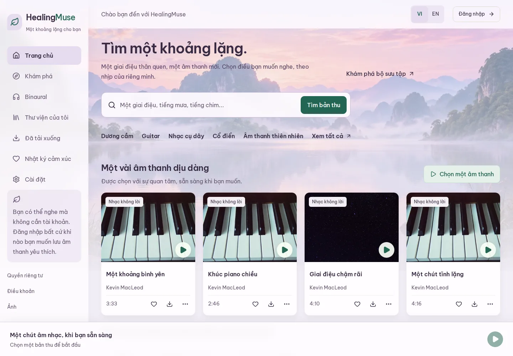
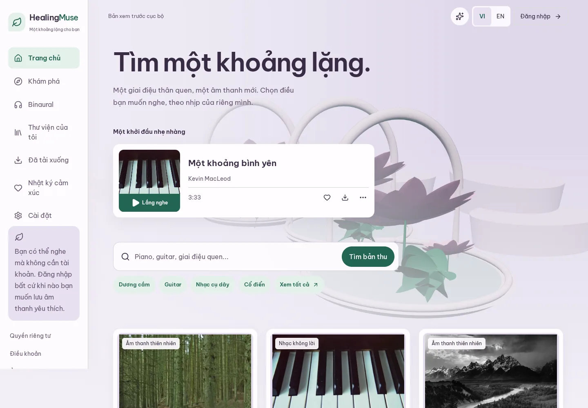
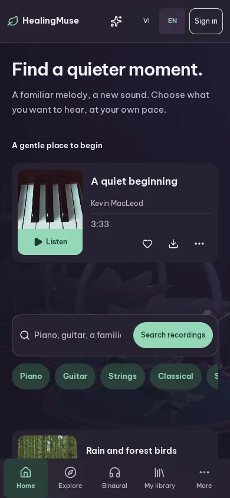
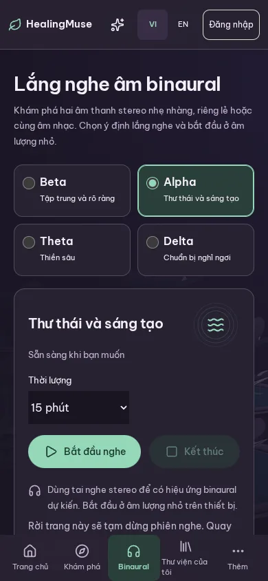

# Botanical world review evidence

This feature is based on `main` containing merged PR #4 (`e35a35c`).
The screenshots show the incumbent local application and the optimized botanical candidate, using the same prepared local catalogue.
The local fixture catalogue includes nature metadata; the production catalogue remains 348 published instrumentals with no published nature recordings.
After screenshots show live procedural rendering, with posters generated from the same scenes available for Still and failure recovery.

## Visual comparisons

| Surface | Before | After |
| --- | --- | --- |
| Vietnamese phone |  |  |
| Vietnamese desktop |  |  |

| English Home at night | Vietnamese Binaural at night |
| --- | --- |
|  |  |

## Performance

Each row contains 30 fresh Vietnamese browser contexts, with cache disabled and service workers blocked.
The viewport is 390 x 844, with 150 ms latency, 1.6 Mbps download and fourfold page CPU slowdown.
All six scenarios passed the p95 three-second usable-control and click-to-audio gates.
Core measurements used the finished graphics and layout; subsequent conditional Night styles corrected queue, storage-panel and account-control contrast without changing the emitted graphics JavaScript.
An additional 30-sample final-build Explore Night confirmation passed at 2,939.8 ms p95 readiness, 1,704.6 ms click-to-audio and 2,616 ms LCP.
The complete performance evidence contains 210 fresh samples.

| Scenario | Ready p95 ms | Audio p95 ms | LCP p95 ms | CLS max | Event p95 ms | Scene p95 ms | Page transfer p95 bytes |
| --- | ---: | ---: | ---: | ---: | ---: | ---: | ---: |
| Home day | 2818.2 | 1200.0 | 548 | 0.0009 | 40 | 5126 | 595438 |
| Explore day | 2924.5 | 1696.0 | 2612 | 0.0335 | 48 | 6003 | 798980 |
| Home night | 2800.5 | 1173.0 | 552 | 0.0009 | 40 | 5072 | 593659 |
| Explore night | 2954.8 | 1688.0 | 2620 | 0.0335 | 48 | 6014 | 798394 |
| Binaural day | 2762.2 | 29.8 | 832 | 0.0024 | 48 | 4824 | 638212 |
| Binaural night | 2765.9 | 31.8 | 816 | 0.0024 | 48 | 4835 | 637126 |

Ordinary audio uses local prepared recordings and detects the native playing event.
Binaural audio uses an AnalyserNode to detect generated PCM, rather than physical headphone output.
Sampled event duration is lab interaction evidence rather than field INP.
Scene readiness is independent of page readiness and has no three-second acceptance requirement.
Every measured scene reached live worker readiness without a page error.
Page-target transferred bytes include completed local audio and assets up to scene readiness, but may omit worker subrequests.
They are not a complete page-weight estimate.
The emitted graphics budget separately counts full matched vendor, worker and shared application chunks, including dependencies.
Actual emitted graphics JavaScript is 194,394 gzip bytes against a 225,280-byte ceiling.
Mobile AVIF posters range from 5,146 to 11,159 bytes against an 81,920-byte ceiling.
No cloud audio was downloaded for these measurements.

## Automated and review evidence

The final route confirmation covers 144 layout states across twelve routes, two languages, two themes and widths of 390, 820 and 1440 pixels.
No horizontal overflow or page errors were found.
All 24 guest Night route accessibility audits passed after correcting the inherited storage-panel background.
The browser suite additionally covers 320-pixel reflow, keyboard focus above fixed controls, dialog focus restoration, reduced motion, reduced transparency, Calm, offline recovery, playlists, queues and locale changes.
Night queue and private check-in selections have explicit regressions.
Signed-in Library, Mood, Settings and Content studio are audited in both languages and themes at three widths.
Renderer tests cover startup failure, unavailable workers, actual WebGL context loss, sustained slow rendering and continued ordinary audio.
The catalogue suite reaches all 348 isolated recordings, the final page, Vietnamese search and every existing facet.

The two independent Impeccable assessments used separate browser inspections and source reviews.
The design reviewer scored the implementation 29/40 before the final correction batch.
That score has not been inflated by a self-assigned post-fix score.
The reviews found better first-action clarity, coherent themes and independent audio recovery.
The correction batch addressed Vietnamese Play wrapping, small links, the redundant Home action, excess spacing, More state visibility and Still parallax.
The deterministic detector was unavailable because its required local engine was missing after a real launcher attempt.
No detector overlay, persisted critique snapshot or historical trend is claimed.

Lint, formatting, strict TypeScript, 70 unit tests, 75 browser tests, portable foundation/catalogue/release/B2 database suites, B2 preflight fixtures, production builds and repository/client-secret scans passed locally.
The client-secret scan used the real configured production output and checked seven configured server-secret variables without displaying their values.
Generated offline files and posters were produced by their source workflows.
No database schema, recording upload, rights, publication, authentication API or playback-grant API change is included.

## Deployed-cloud and manual boundaries

The existing production baseline returned HTTP 200 for Home in both languages, Explore and Binaural.
All 348 unique published IDs were unchanged across eight pages, including the 12-recording final page and last-ID lookup.
No nature recordings were published, and anonymous administrator access returned HTTP 401 with no-store caching.
That baseline is the previous design and does not prove the botanical candidate has deployed.

GitHub CI and the existing project's Vercel Preview check are inspected separately on the feature PR.
The owning user reviews and merges before automatic Production deployment.
Protected preview account testing, final public deployment checks and cloud playback/performance remain pending that rollout and verified audio allowance.
Physical iPhone/Android rendering, hardware GPU behavior, native enlarged-text settings, actual NVDA/VoiceOver/TalkBack and physical headphone output remain pending.
