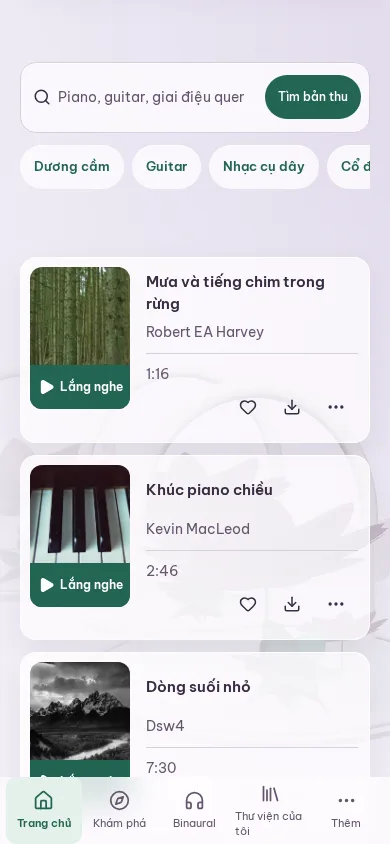
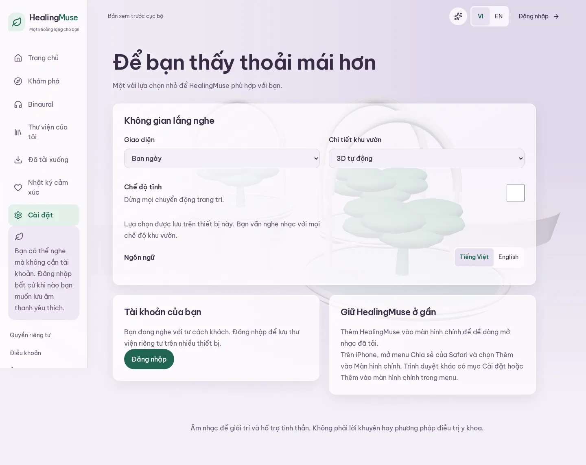

# Fluid motion and botanical glass

This refinement preserves the authored botanical environments, lavender/jade identity and self-hosted Be Vietnam Pro.
The selected direction is fluid, noticeable motion with more transparent panels throughout.

## Visual comparisons

Phone captures use a 390 × 844 viewport.
The Settings comparison shows translucent surfaces and a Calm checkbox that remains beside its description.

| Before                                                                 | Final candidate                                                                     |
| ---------------------------------------------------------------------- | ----------------------------------------------------------------------------------- |
|  |  |

The secondary Home listening rows now use one-line Vietnamese Play labels in 100 × 44 pixel artwork bands.
The Home capture is scrolled to these rows.
It uses the isolated local source catalogue, which includes historical nature fixtures; production still contains 348 instrumentals.

The Night appearance dialog retains the current garden and disables movement in Calm.

The desktop comparison shows the opaque baseline and the glass composition inspected during the independent review.
The latter predates the final motion and phone corrections; desktop typography, surfaces and panel grouping remain the same.
These captures have different document heights and should be compared for composition rather than pixel diffs.

| Baseline                                                            | Reviewed glass composition                                                           |
| ------------------------------------------------------------------- | ------------------------------------------------------------------------------------ |
|  |  |

## Motion and behavior

CSS starts heading entrances when content enters the document, avoiding a late JavaScript repositioning.
A shared IntersectionObserver and scoped GSAP context handle streamed surfaces, later cards and reused catalogue results.
The initial listening targets remain stationary, later cards rise by 14 pixels, and list staggering is capped at 140 ms.
Artwork fades independently so recording labels and listening controls retain contrast.
Controls provide short press feedback, selections acknowledge state, and dialogs animate their opening and closing through Radix Presence.
Calm applies before hydration and to portals, while reduced motion disables decorative transitions.
Reduced transparency supplies opaque fills and removes backdrop blur.
The scenery host and persistent audio provider retain separate lifecycles.

## Evidence and limits

Two initial assessments inspected the candidate separately, followed by a directed confirmation of the identified fixes.
The design assessment scored the inspected build 30/40 before the correction batch.
The browser assessment recorded 39 axe scans without violations and sampled rendered Settings text contrast between 5.10:1 and 7.42:1.
Automated color-contrast analysis was incomplete over some glass surfaces, so sampled rendered contrast supplements it.
The final narrow browser confirmation verified all five corrected findings.
The Impeccable detector and archive helper could not run because engine 0.1.14 was unavailable; no detector overlay, snapshot or trend is claimed.

The regression suite is [fluid-glass.spec.ts](../../e2e/fluid-glass.spec.ts).
It covers route and reused-result arrivals, persistent playback, lower-card motion, repeated dialog focus, Calm, reduced motion, reduced transparency and phone label/control grouping.
Held-pointer checks verify that fixed navigation stays in place and activates correctly in Calm and reduced motion.
The full application suite also exercises catalogue, personal, binaural and offline behavior.
The root [README](../../../README.md#validation-and-performance) documents the commands and the three-second mobile listening gate.
Performance evidence uses 30 fresh samples per Home, Explore and Binaural theme scenario at the agreed throttle.
Raw browser and timing reports stay in ignored local artifacts, with measured summaries in the pull request.
Cloud metadata was checked separately: all 348 unique published IDs were discovered across eight 48-item pages, with 12 on the final page and no nature recordings.
That check downloaded no cloud music.
Actual screen-reader, physical-device, physical-headphone and deployed-candidate performance checks remain separate and pending.
