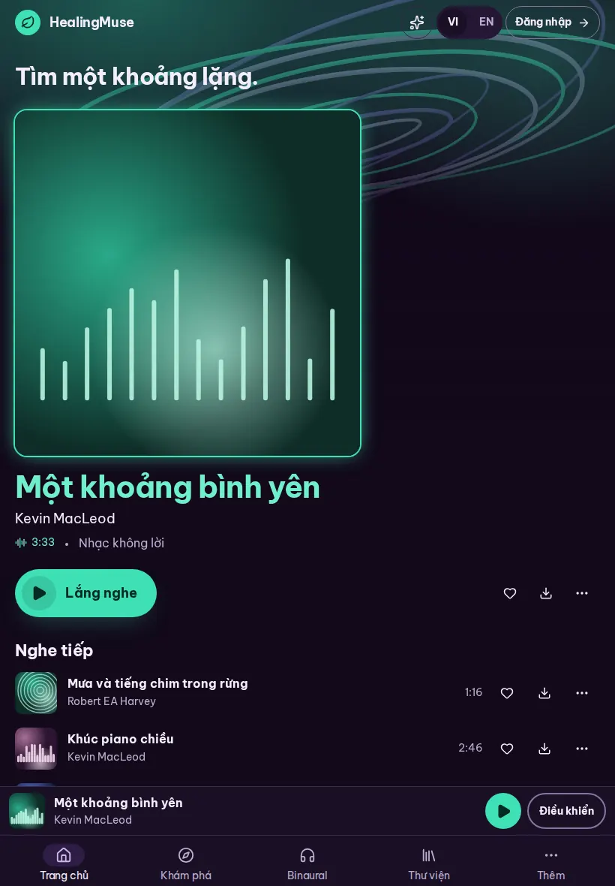
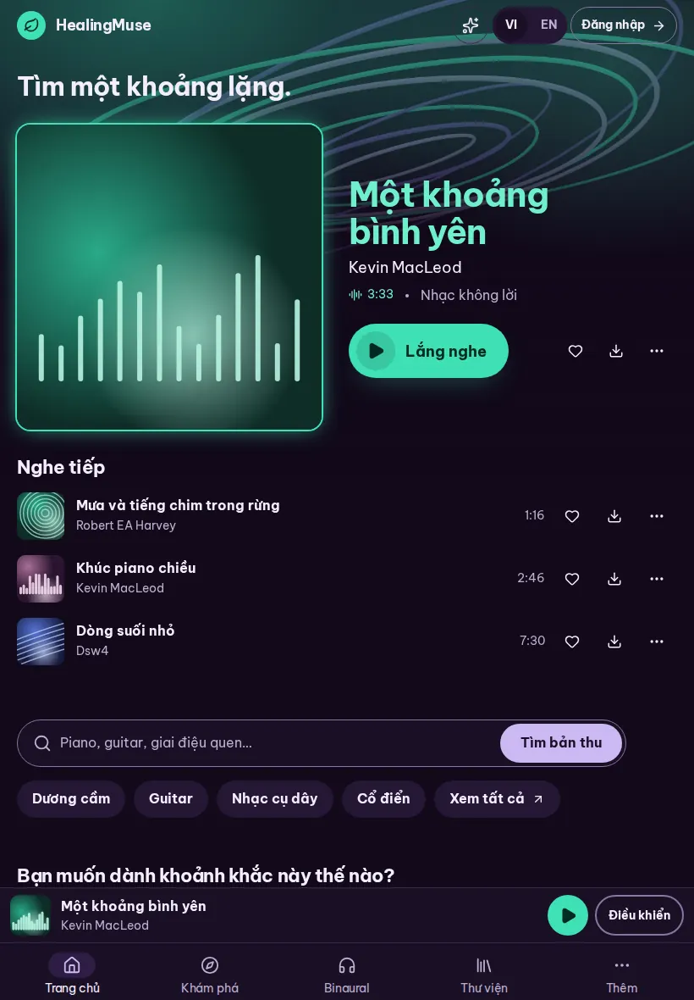
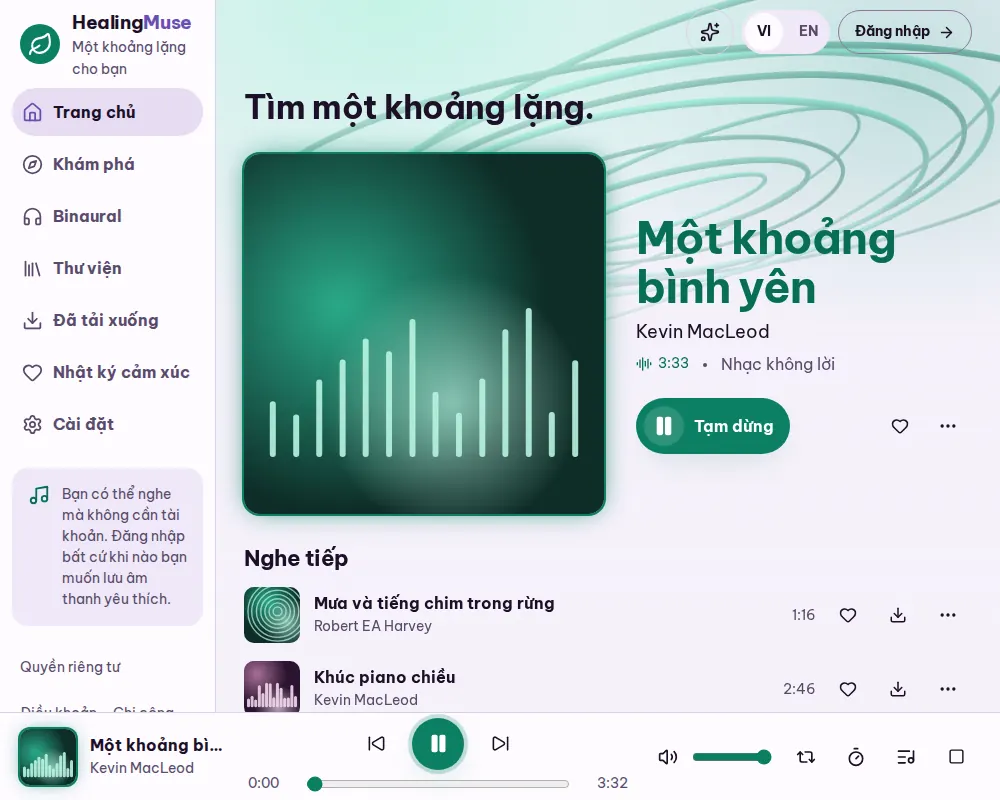
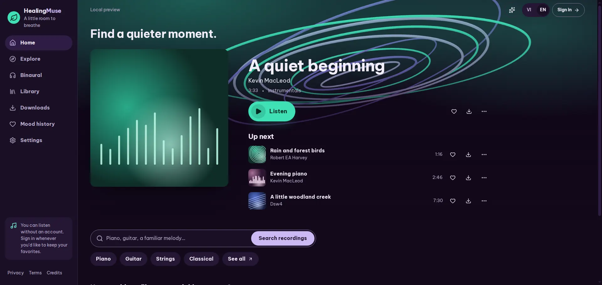
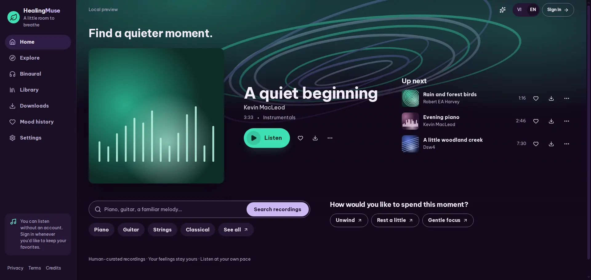
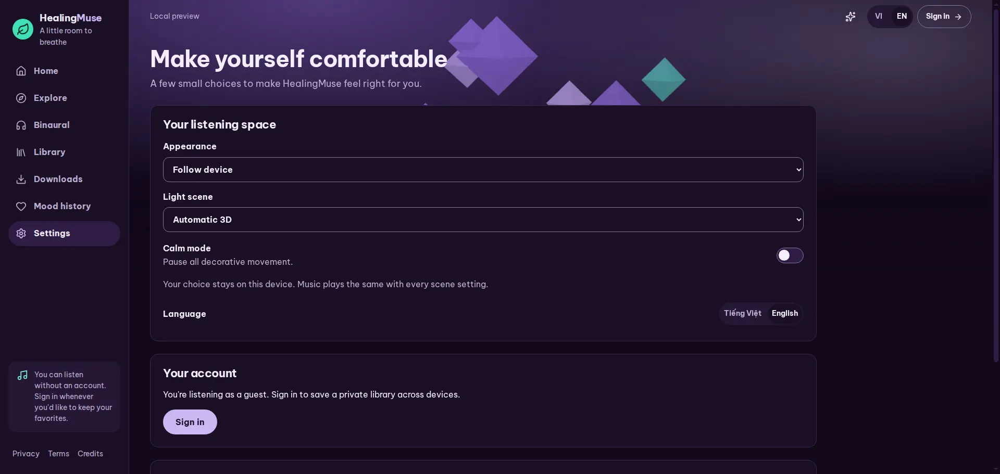
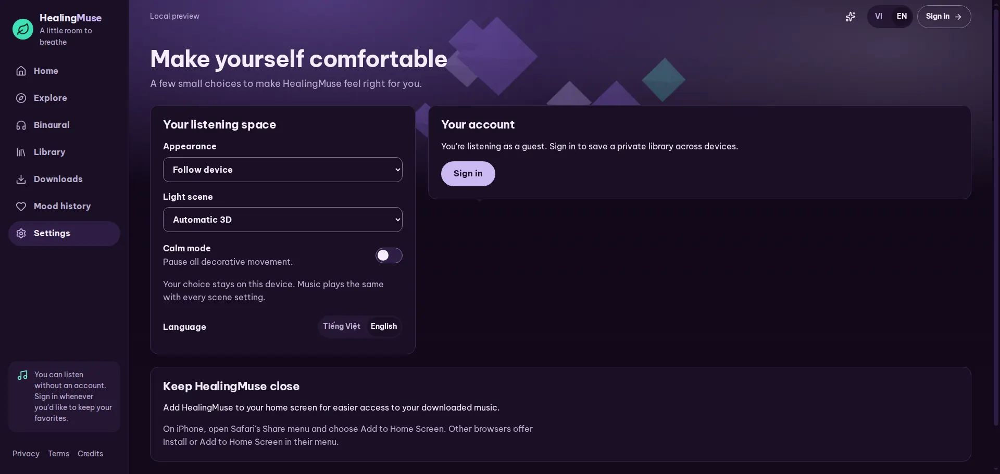
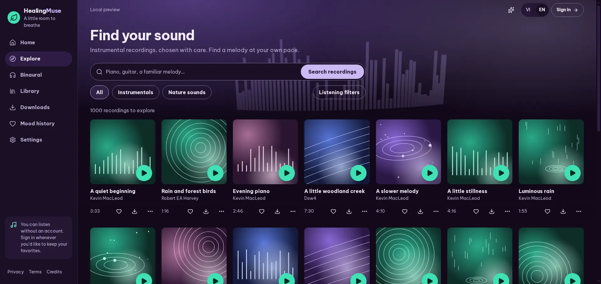

# Night-mode music world

This redesign replaces the botanical world with a night-mode music app.
It keeps the leaf logo, the lavender, plum and jade identity, self-hosted Be Vietnam Pro, every route and the five phone destinations.
Type uses two weights only: bold for names and actions, regular for running text and values (the phone tab labels are regular so they do not crowd).
Jade is spent only on listening: Play controls, the hero Listen pill, the binaural Start button, progress, the playing ring and the logo mark.
Every recording gets a cover generated from its id, so the catalogue needs no photographs.

All captures come from local preview builds with the isolated local catalogue, reduced motion and the still scene, so they are deterministic.
"Before" is merged main (PR 1); "after" is this branch.
Phone captures use 390 × 844 with touch emulation unless the name says otherwise.

## Home on a phone

| Before                                                  | After, night                                                                          | After, day (English)                                 |
| ------------------------------------------------------- | ------------------------------------------------------------------------------------- | ---------------------------------------------------- |
|  |  |  |

The featured recording leads with its generated cover, the jade Listen pill, and favourite, download and details.
Up next lists the following recordings as lines whose covers carry a jade Play badge on touch.

## Explore on desktop

| Before                                                          | After, night                                                                           |
| --------------------------------------------------------------- | -------------------------------------------------------------------------------------- |
|  |  |

## Recording lines on touch and narrow screens

The timed gate found that touch phones hid Play on recording lines until hover, which a touch screen cannot do.
Each line's cover now carries an opaque jade Play badge in its bottom corner, and the whole cover stays the target.
A downloaded recording's check is a small corner mark clear of the badge.

| Explore lines (touch, night)                                                    | Downloads (touch, night)                                                                      | Explore at 320 px (day)                                  |
| ------------------------------------------------------------------------------- | --------------------------------------------------------------------------------------------- | -------------------------------------------------------- |
|  |  |  |

Downloads and the Binaural picker now read as lines on phones, like Explore and Library, instead of 350 px tiles.
A line narrower than 340 px folds download and favourite into the details sheet (a saved heart stays) and sets the duration beside the artist, so names keep at least 140 px.
At 320 px the five tab labels size to their words, so "Trang chủ" and "Khám phá" stay at least 8 px apart.

At 1024 px Home's featured column is narrow beside its cover.
It takes the compact Listen pill and leaves Download in details, so nothing reaches past the page and Listen, favourite and details keep one line.
The narrower sidebar keeps every destination on one line ("Nhật ký cảm xúc" used to wrap), and the legal links at its foot are spaced with no separators, so none is stranded at a line's end.

## Home on a tablet

| Stacked, as first built (820 by 1180) | Cover beside the name, the owner's choice |
| --- | --- |
|  |  |

From 700 to 1023 px Home sets the featured cover, at most 360 px, beside its name, metadata and Listen, and runs up next across the full width below; the owner chose this on 2026-11-11.
Stacked, the cover filled the width at 820 by 1180, Listen ended about 820 px down and two lines up next showed above the docked mini player.
Beside the name, Listen ends at 446 px and three lines up next show in full.
Below 700 px Home stays stacked, and from 1024 px up next moves beside the cover as before.

At 1000 by 800 and 1023 by 768, where the sidebar and the player bar take their room, the stacked layout put Listen below the fold.
Beside the name it ends at 454 px at 1000 by 800, and the first line up next ends above the player bar.
A name column narrower than 350 px (700 to about 780 px, and 900 to 1023 px with a desktop scrollbar) takes the compact Listen pill, as at 1024 px.

## Wide screens

| A 1280 px column at the left (1920 by 911, with a desktop scrollbar) | The page fills the width, the owner's choice |
| --- | --- |
|  |  |
|  |  |

On a 1920 px window the page stopped 1280 px wide at the left while the top bar's controls sat at the window's edge, so their edges missed by 297 px, and controls drifted from what they act on: Listen's favourite, download and details sat 482 px from it, and Settings' selects were 1230 px wide.
The owner chose filling the width on 2026-11-12.
The page now fills the space beside the sidebar with the top bar's gutters, and from 1600 px Home sets the cover, the name and up next in three columns, with its search beside the moments to listen for.
Fields grow to 32rem at most, a setting's switch stays within that width, Settings sits in three columns from 1600 px, and Listen's actions follow it wherever the name sits beside the cover.

Explore shows seven tiles a row at 1920 px, and its search, the kinds and Listening filters form one block of at most 880 px; the filters open from the kinds' row.
Beside the sidebar the document keeps room for a desktop scrollbar on every page, so the top bar no longer moves 15 px between a page that scrolls and one that does not.

## Binaural

Band names stay, with Hz ranges and sound descriptors that make no claim about a brain state.

## Evidence and limits

The regression suites are [mobile-player.spec.ts](../../e2e/mobile-player.spec.ts) for touch, pointer, narrow and downloaded lines and for Home's featured composition from 699 to 1920 px, [wide-layout.spec.ts](../../e2e/wide-layout.spec.ts) for wide screens (the frame, the scrollbar gutter, Listen's actions, Explore's controls and field widths), [navigation.spec.ts](../../e2e/navigation.spec.ts) for the 320 px tabs, and [personal-features.spec.ts](../../e2e/personal-features.spec.ts) for a saved heart on a narrow line, a release's manifest digest inside its review and the mood tables' last row.
[navigation.spec.ts](../../e2e/navigation.spec.ts) also holds the sidebar's one-line destinations and its legal links, and [typography.test.ts](../../unit/typography.test.ts) keeps the type to two weights.
Each new test was run against the build without its fix and failed for the defect it names.
The full Playwright suite passes against the real local catalogue.
Two finish-review rounds and two adversarial review rounds inspected the redesign; their screenshots stay in ignored local files.
Deployed preview, physical device and real screen reader checks were not collected for these captures.
