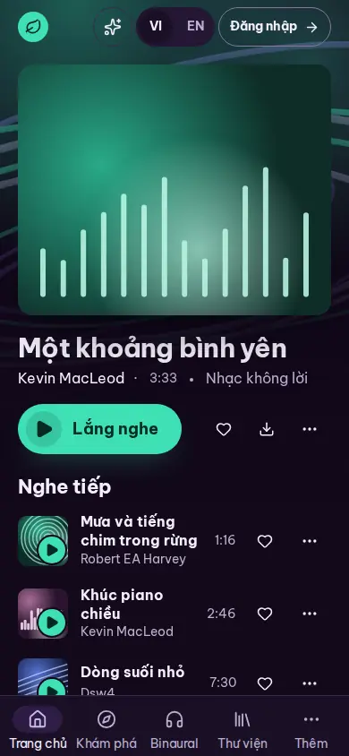
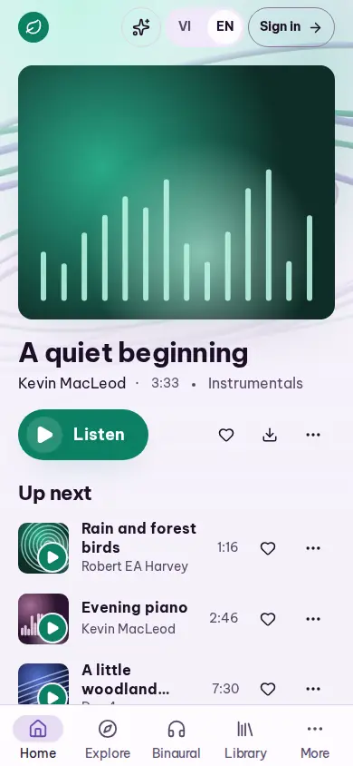
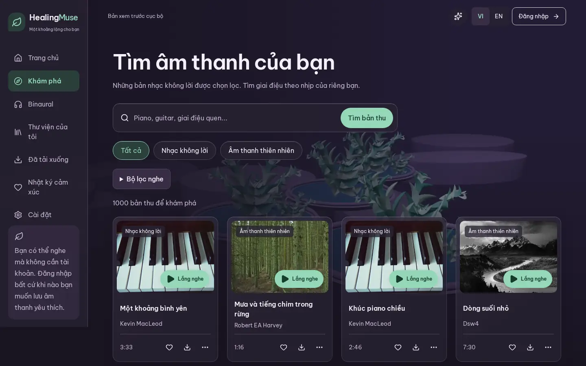
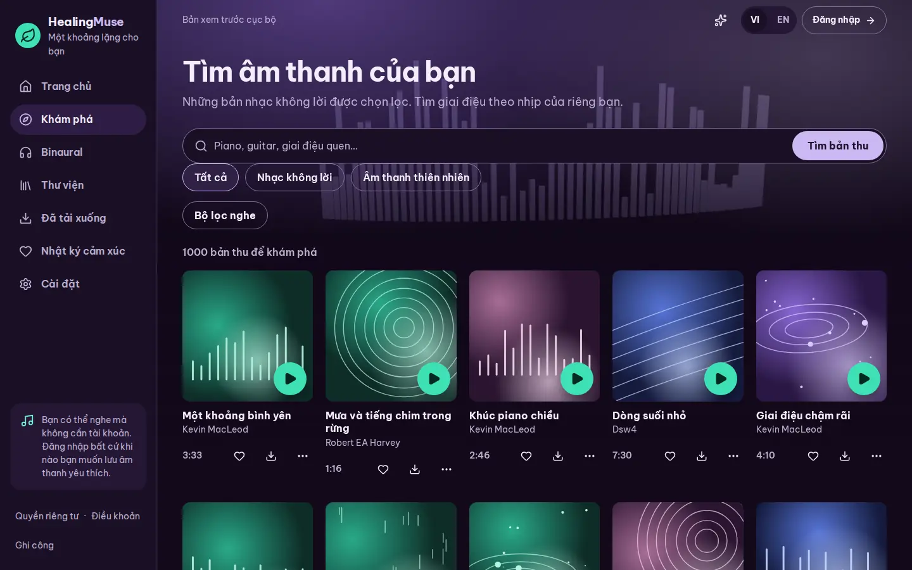
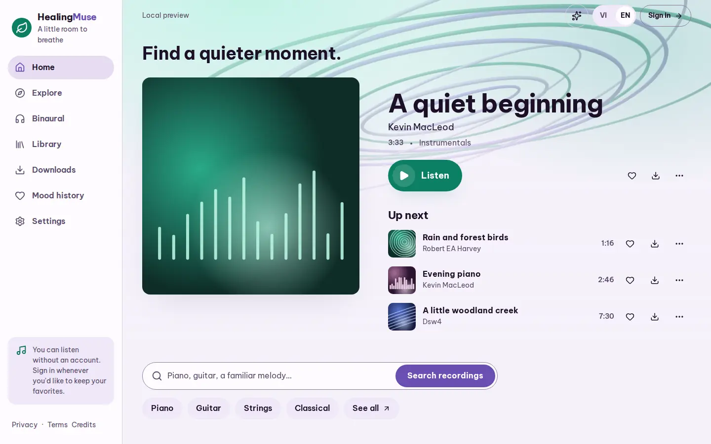
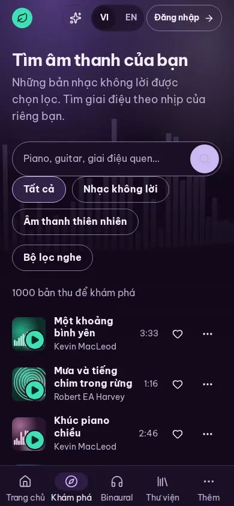
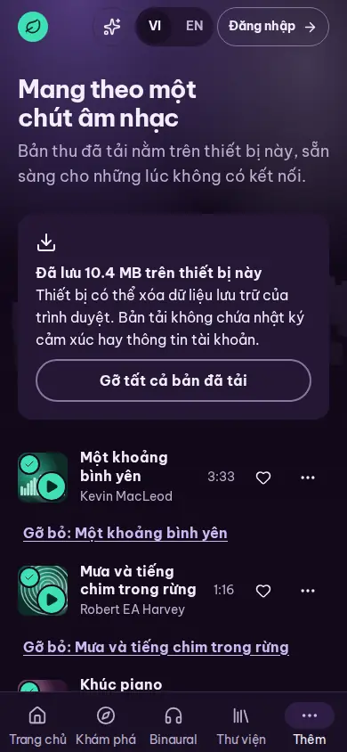
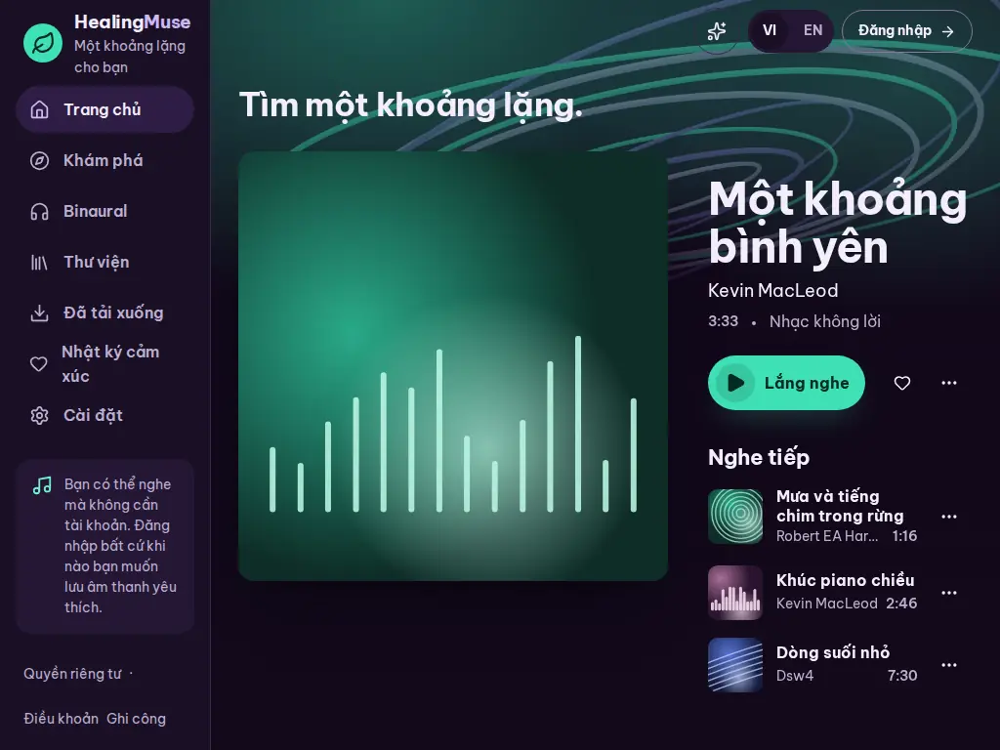
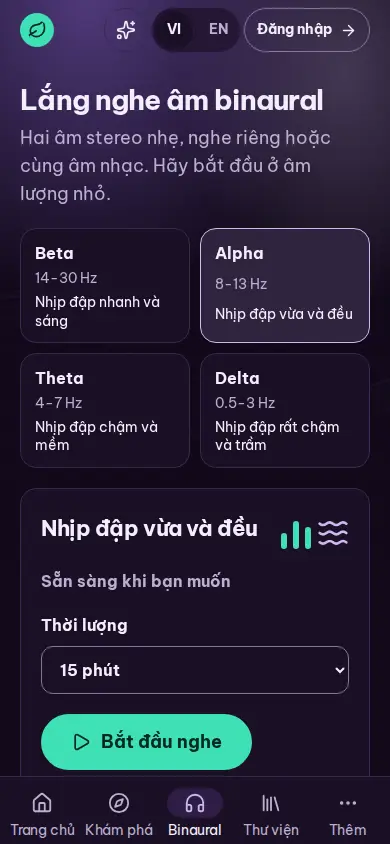

# Night-mode music world

This redesign replaces the botanical world with a night-mode music app.
It keeps the leaf logo, the lavender, plum and jade identity, self-hosted Be Vietnam Pro, every route and the five phone destinations.
Type uses two weights only: bold for names and actions, regular for running text and values (the phone tab labels are regular so they do not crowd).
Jade is spent only on listening: Play controls, the hero Listen pill, the binaural Start button, progress, the playing ring and the logo mark.
Every recording gets a cover generated from its id, so the catalogue needs no photographs.

All captures come from local preview builds with the isolated local catalogue, reduced motion and the still scene, so they are deterministic.
"Before" is merged main (PR 1); "after" is this branch.
Phone captures use 390 × 844 with touch emulation unless the name says otherwise.

## Home on a phone

| Before                                                  | After, night                                                                          | After, day (English)                                 |
| ------------------------------------------------------- | ------------------------------------------------------------------------------------- | ---------------------------------------------------- |
|  |  |  |

The featured recording leads with its generated cover, the jade Listen pill, and favourite, download and details.
Up next lists the following recordings as lines whose covers carry a jade Play badge on touch.

## Explore on desktop

| Before                                                          | After, night                                                                           |
| --------------------------------------------------------------- | -------------------------------------------------------------------------------------- |
|  |  |

## Recording lines on touch and narrow screens

The timed gate found that touch phones hid Play on recording lines until hover, which a touch screen cannot do.
Each line's cover now carries an opaque jade Play badge in its bottom corner, and the whole cover stays the target.
A downloaded recording's check is a small corner mark clear of the badge.

| Explore lines (touch, night)                                                    | Downloads (touch, night)                                                                      | Explore at 320 px (day)                                  |
| ------------------------------------------------------------------------------- | --------------------------------------------------------------------------------------------- | -------------------------------------------------------- |
|  |  |  |

Downloads and the Binaural picker now read as lines on phones, like Explore and Library, instead of 350 px tiles.
A line narrower than 340 px folds download and favourite into the details sheet (a saved heart stays) and sets the duration beside the artist, so names keep at least 140 px.
At 320 px the five tab labels size to their words, so "Trang chủ" and "Khám phá" stay at least 8 px apart.

At 1024 px Home's featured column is narrow beside its cover.
It takes the compact Listen pill and leaves Download in details, so nothing reaches past the page and Listen, favourite and details keep one line.
The narrower sidebar keeps every destination on one line ("Nhật ký cảm xúc" used to wrap), and the legal links at its foot are spaced with no separators, so none is stranded at a line's end.

## Binaural

Band names stay, with Hz ranges and sound descriptors that make no claim about a brain state.

## Evidence and limits

The regression suites are [mobile-player.spec.ts](../../e2e/mobile-player.spec.ts) for touch, pointer, narrow and downloaded lines, [navigation.spec.ts](../../e2e/navigation.spec.ts) for the 320 px tabs, and [personal-features.spec.ts](../../e2e/personal-features.spec.ts) for a saved heart on a narrow line.
[navigation.spec.ts](../../e2e/navigation.spec.ts) also holds the sidebar's one-line destinations and its legal links, and [typography.test.ts](../../unit/typography.test.ts) keeps the type to two weights.
Each new test was run against the build without its fix and failed for the defect it names.
The full Playwright suite passes against the real local catalogue.
Two finish-review rounds and two adversarial review rounds inspected the redesign; their screenshots stay in ignored local files.
Deployed preview, physical device and real screen reader checks were not collected for these captures.
