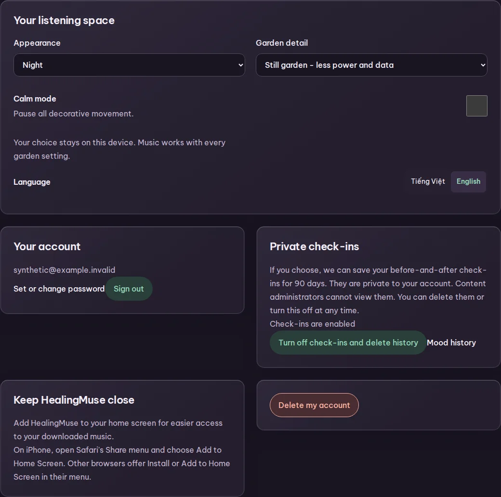
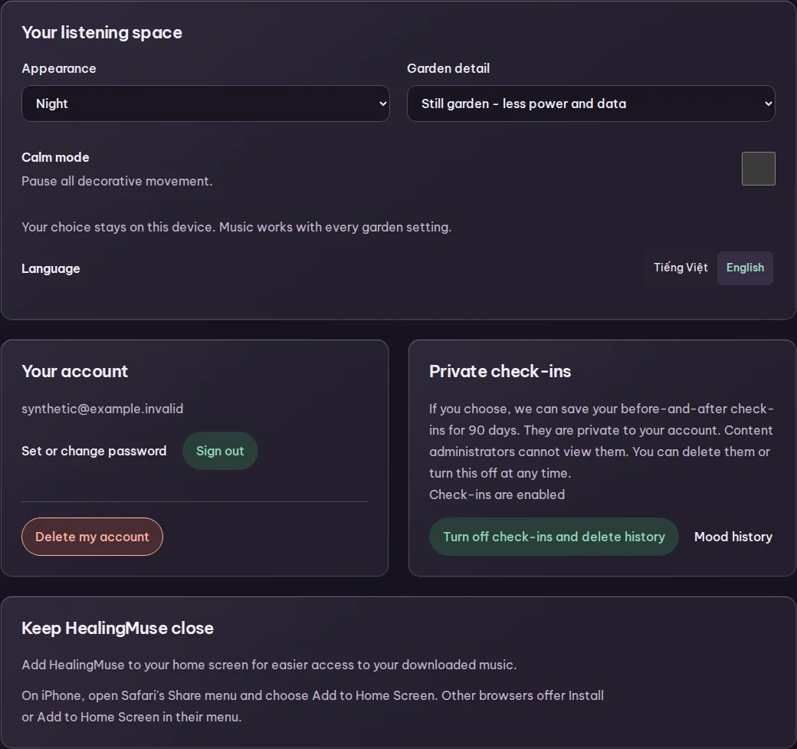
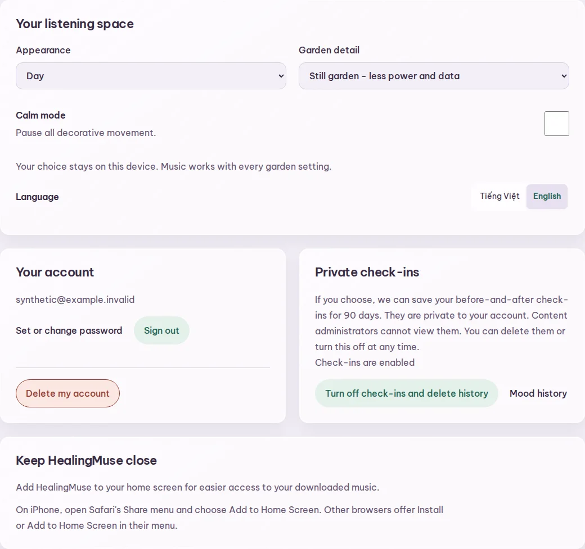
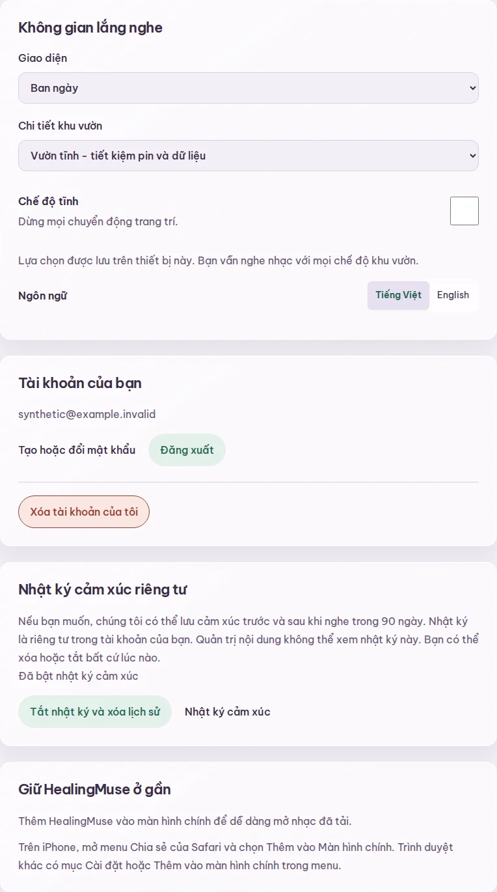
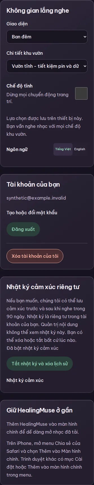

# Scroll stability and Settings composition

Clicking ordinary page content previously focused the `tabindex="-1"` main container.
The shared focus handler treated its full page height as an obscured control and scrolled toward its bottom.
The browser reproduction observed jumps on Home, Explore, Binaural and Settings at 390 and 1440 pixels wide.
On phone Home, one heading click moved the page from 0 to 948 pixels down.

The handler now excludes the main container and pointer focus while retaining the reveal behavior for keyboard focus above fixed playback and navigation surfaces.
Skip navigation keeps its native focus target.
The regression in [scroll-position.spec.ts](../../e2e/scroll-position.spec.ts) clicks headings and supporting copy across all four routes, including content reached after scrolling.
Existing botanical tests check that keyboard-focused recording actions remain unobscured.

## Settings layout

Appearance leads the page across its full width.
Account and private check-ins share aligned desktop boundaries, with explicit spacing between their actions.
Account deletion sits in a separated footer inside the account section.
Installation guidance uses a full-width supporting section.
The layout collapses to one column on tablet and phone, preserving DOM and keyboard order.
Long email addresses can wrap within the account panel.
Panel heights follow content without fixed height constraints.

| Before | Corrected layout |
| --- | --- |
|  |  |

| Vietnamese tablet | Vietnamese phone |
| --- | --- |
|  |  |

## Evidence boundaries

These captures use the real Settings component, production styles and self-hosted Be Vietnam Pro in the isolated authenticated browser fixture.
The account and private data are synthetic.
The baseline uses the component and interaction stylesheet from main commit `eef0534`.
Captures show the Settings section without the application shell or garden scenery.
They document grouping, typography and responsive layout rather than a cloud deployment.

The personal-feature fixture now imports the production interaction stylesheet and fonts, closing a coverage gap in earlier responsive checks.
Its tests cover both languages and themes at phone, tablet and desktop sizes, including aligned panel edges, wrapping action gaps, 44-pixel targets, contrast analysis and account dialogs.
Dialog target measurements wait for the entrance animation to settle before asserting the 44-pixel minimum.
Independent Impeccable layout and mechanical assessments informed this correction.
The detector engine was unavailable, so no completed detector scan is claimed.
Physical-device, actual screen-reader and deployed-candidate checks remain pending.
